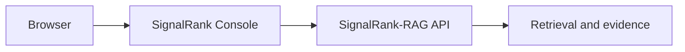

# SignalRank Console

React + TypeScript interface for SignalRank-RAG.

SignalRank Console is the browser-facing product layer for querying SignalRank-RAG, inspecting answers and evidence, and controlling retrieval behavior.

## Architecture



SignalRank Console focuses on frontend and product engineering; retrieval and LLM functionality remain in SignalRank-RAG.

## Status

Early development.

Currently implemented:

- React + TypeScript application shell
- SignalRank API health checking
- Environment-based API configuration
- Responsive query and result interface

## Development

Requires Node.js and npm.

Create `.env.local` from `.env.example`, then run:

```bash
npm install
npm run dev
```

Configure the SignalRank API endpoint in `.env.local`:

```env
VITE_SIGNALRANK_API_BASE_URL=http://localhost:8000
```

## Quality checks

```bash
npm run lint
npm run build
```

## Related project

[SignalRank-RAG](https://github.com/bksampadi/SignalRank-RAG) — retrieval-augmented generation backend used by this console.

## Stack

- TypeScript
- React
- Vite
- ESLint